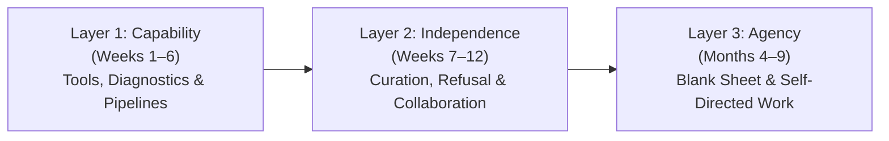
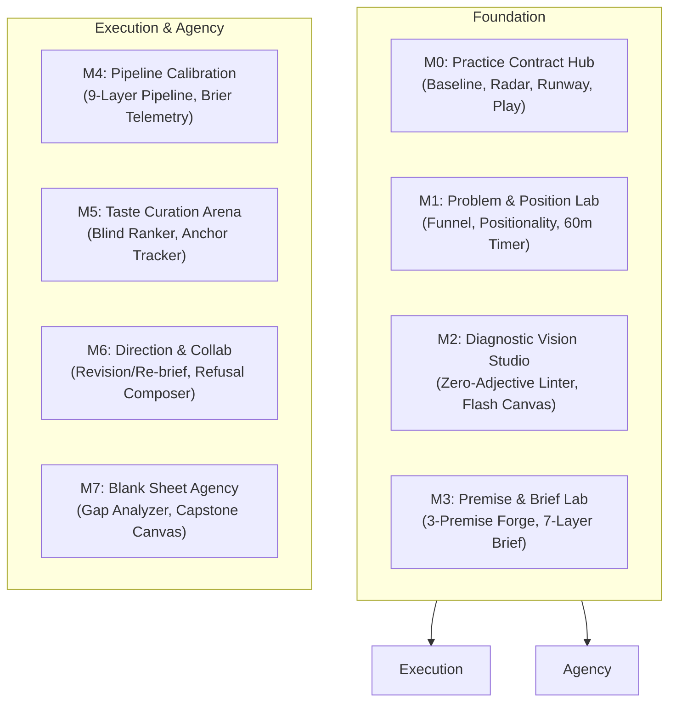

# Directing the Machine

> *A Deliberate Practice Environment for Creative Authorship, Diagnostic Vision, and Calibrated Direction in an AI-Augmented World.*
> 
> **Conceived, written, engineered, and maintained by [Rahul Rajeev](https://github.com/drawablex86).**

---

## Table of Contents
1. [Overview & Philosophy](#1-overview--philosophy)
2. [The Core Mechanics](#2-the-core-mechanics)
   - [The 3 Mastery Layers](#the-3-mastery-layers)
   - [Scaffolding Removal Engine](#the-scaffolding-removal-engine)
   - [The 8-Step Daily Practice Loop](#the-8-step-daily-practice-loop)
   - [Anti-Overbuilding & Anti-Theatre Guardrails](#anti-overbuilding--anti-theatre-guardrails)
   - [The 8 Studio Modalities (M0–M7)](#the-8-studio-modalities-m0m7)
   - [Projects 1 through 12](#projects-1-through-12)
3. [How-To Instructions](#3-how-to-instructions)
   - [For Practitioners & Learners](#for-practitioners--learners)
   - [For Developers & Contributors](#for-developers--contributors)
4. [Code Architecture & Technical Blueprint](#4-code-architecture--technical-blueprint)
   - [Tech Stack](#tech-stack)
   - [System Architecture Diagram](#system-architecture-diagram)
   - [Directory Structure](#directory-structure)
   - [State Management & Data Flow](#state-management--data-flow)
   - [Core Engines & Utilities](#core-engines--utilities)
   - [Data Layer](#data-layer)
   - [UI Component Taxonomy](#ui-component-taxonomy)
   - [Multi-Modal Inclusivity & Accessibility](#multi-modal-inclusivity--accessibility)
5. [License & Attribution](#5-license--attribution)

---

## 1. Overview & Philosophy

### Context & The Problem
In an era where generative artificial intelligence collapses the marginal cost of execution and generation to zero, the nature of creative labor has bifurcated. When anyone can generate infinite high-fidelity images, polished prose, or functional code in seconds with generic prompts, *generation itself ceases to be a competitive differentiator*. 

The failure mode of the current generation of practitioners is **amateur prompt slop**: superficial aesthetic polish masking hollow structure, wandering themes, uncalibrated taste, and total absence of intentional agency.

### The Purpose
**Directing the Machine** is not a prompt book or a collection of hacks. It is a rigorous, university-grade deliberate practice curriculum and local-first interactive software studio designed to cultivate:
- **Diagnostic Vision**: The ability to see structural flaws, composition gaps, and thematic failures without hiding behind vague adjectives (*"looks cool"*, *"feels off"*).
- **Calibrated Taste**: Developing an explicit, defensible aesthetic standard tested against blind comparisons and mathematical confidence telemetry.
- **Direction & Refusal**: Formulating multi-layered creative briefs, orchestrating revision vs. re-brief forks, and knowing when to refuse generation entirely.
- **Blank-Sheet Artistic Agency**: Finding problems in the world, taking an ethical and authorial position, and building original work from an unassigned beginning.

### Key Documents in the Repository
- [`AGENT.md`](file:///Users/rahulrajeev/Downloads/directing-the-machine/AGENT.md): Operational manual for autonomous AI agents and mandatory documentation synchronization protocol.
- [`docs/ARCHITECTURE.md`](file:///Users/rahulrajeev/Downloads/directing-the-machine/docs/ARCHITECTURE.md): Full technical architecture blueprint, reactive state engine, and subsystem guide.
- [`docs/DESIGN_SYSTEM.md`](file:///Users/rahulrajeev/Downloads/directing-the-machine/docs/DESIGN_SYSTEM.md): Kepano Stone & Paper design system, color tokens, and WCAG AAA contrast specifications.
- [`README.md`](file:///Users/rahulrajeev/Downloads/directing-the-machine/README.md): High-level feature overview, quickstart commands, and Vercel hosting deployment.
- [`Directing the Machine.md`](file:///Users/rahulrajeev/Downloads/directing-the-machine/Directing%20the%20Machine.md): The full master textbook and curriculum reference (19 modules, 15 appendices A–O).
- [`Instructions.md`](file:///Users/rahulrajeev/Downloads/directing-the-machine/Instructions.md): Complete UI/UX specification, anti-overbuilding rules, and implementation protocols.
- [`SEO_STRATEGY.md`](file:///Users/rahulrajeev/Downloads/directing-the-machine/SEO_STRATEGY.md): Comprehensive search engine optimization strategy and discovery architecture.
- [`Project 7 — Visual Campaign (Month 4).md`](file:///Users/rahulrajeev/Downloads/directing-the-machine/Project%207%20%E2%80%94%20Visual%20Campaign%20(Month%204).md) through [`Project 12 — Capstone (Month 9).md`](file:///Users/rahulrajeev/Downloads/directing-the-machine/Project%2012%20%E2%80%94%20Capstone%20(Month%209).md): Detailed independent capstone dossiers for Months 4 through 9.
- [`TASKS.md`](file:///Users/rahulrajeev/Downloads/directing-the-machine/TASKS.md): Step-by-step engineering roadmap and implementation log.

---

## 2. The Core Mechanics

The studio implements the pedagogical mechanics specified in the master curriculum through active software guardrails.

### The 3 Mastery Layers



1. **Layer 1: Capability (Weeks 1–6)**: Establishing baseline diagnostic vision, learning 7-layer briefs, calibrating pipeline confidence, and mastering the top-down diagnostic ladder.
2. **Layer 2: Independence (Weeks 7–12)**: Evaluating outputs blindly without provenance bias, handling stakeholder critique, executing principled refusals, and leading cross-medium synthesis.
3. **Layer 3: Agency (Months 4–9 / Projects 7–12)**: Working without prompts, categories, or externally supplied exercises; noticing problems in the wild; operating from an unassigned blank sheet.

### Scaffolding Removal Engine
As learners advance through the curriculum, the user interface **dynamically removes support scaffolds** to force the internalisation of tacit knowledge rather than mechanical compliance:

| Stage | Scaffolding Supplied by Studio UI | Scaffolding Removed from Studio UI | Target Layer |
| :--- | :--- | :--- | :--- |
| **Part I (Wks 1–2)** | Visible Diagnostic Ladder, exercise prompts, reference templates | None | Layer 1 |
| **Part II (Wks 3–4)** | 7-layer brief builder, exercise prompts | **Diagnostic Ladder hidden by default** | Layer 1 |
| **Part III (Wks 5–6)** | Pipeline mapper, Brier confidence calculator | **Brief templates removed** (blank brief composer) | Layer 1 |
| **Part IV (Wks 7–8)** | Broad category prompts, Blind Taste Arena | **Pre-written exercise removed** | Layer 1 → 2 |
| **Part V (Wks 9–10)** | Stakeholder situation simulators | **Broad category removed** | Layer 2 |
| **Part VI (Wks 11–12)**| Practical boundary conditions only (time/medium) | **Situations, ladders, and templates removed** | Layer 2 |
| **Months 4–7** | Milestone checklists, high-level dossiers | External mentor scaffolding removed | Layer 2 → 3 |
| **Months 8–9** | **Nothing** (Unassigned Beginning canvas only) | **Even the problem prompt itself is removed** | Layer 3 |

### The 8-Step Daily Practice Loop
Every active training day follows an eight-part deliberate practice rhythm:
1. **Read (20m)**: Targeted module concepts and mental models.
2. **Practise (60m)**: Deliberate practice drills operating at 70–80% success rate.
3. **Study (60m)**: Close reading of masterworks, reverse prompts, and structural deconstruction.
4. **Make (2h)**: Primary production rep advancing the active project milestone.
5. **Diagnose (30m)**: Zero-adjective structural breakdown of the generated work.
6. **Log (10m)**: Strict 10-minute cap entry into Problem, Decision, Practice, or Calibration logs.
7. **Transfer (30m)**: Cross-medium testing (applying visual principles to writing, or vice versa).
8. **Play (30m)**: Non-instrumental play with all rubrics disabled and single-line recording.

### Anti-Overbuilding & Anti-Theatre Guardrails
To prevent learners from turning deliberate practice into passive reading or logging bureaucracy:
- **10-Minute Log Cap**: All logging interfaces enforce a hard 10-minute countdown. Upon expiration, inputs auto-save and lock with the reminder: *"The document is not the practice. Go make something."*
- **Log Decay Detector**: The math engine audits log history. If a user enters identical confidence ratings ($70\%$) five times consecutively or repeats canned phrasing, it detects habit decay and prompts a field rotation.
- **Zero-Adjective Linter**: A live regex engine highlights evaluative shortcuts (*good, bad, beautiful, ugly, strong, weak, polished, clean*) in diagnostic notes, requiring users to describe concrete visual and structural phenomena.
- **Brier Score Calibration**: Pre-run confidence locks track how well the practitioner predicts model output quality before generation, calculating personal calibration curves over time.
- **Hemingway Stop Hook**: Every session requires learners to stop *before* cognitive exhaustion and state their concrete first action for tomorrow, preserving creative momentum.

---

### The 8 Studio Modalities (M0–M7)



- **`M0: practice-contract-hub`**: 12-competency baseline self-assessment radar, Appendix O intensity path selection, runway calculator, and protected non-instrumental play timer.
- **`M1: problem-position-lab`**: 6-step problem-finding funnel (`Notice → Collect → Frame → Test → Select → Justify`), Positionality Compass (`From | With | For | About | Over`), and 60-minute unassigned beginning timer.
- **`M2: diagnostic-vision-studio`**: Zero-adjective observation linter, 6-question human decision audit, 5-second flash memory reconstruction canvas, and close-reading text annotation diffs.
- **`M3: premise-brief-lab`**: 3-premise viability matrix with explicit rejection logic, 7-layer brief architect, constraint density tri-view (3 / 6 / 10), and provenance stamp.
- **`M4: pipeline-calibration`**: 9-layer generative pipeline mapper, pre-run confidence locks, Brier score calculations, and taste-narrowness alert.
- **`M5: taste-curation-arena`**: 5-part taste formula calculator, blind provenance ranker (scrambling AI vs. human labels), and $\ge 40\%$ human anchor tracking.
- **`M6: direction-collab`**: Revision vs. re-brief decision fork, 5-mode refusal composer (ethical, aesthetic, economic, epistemic, boundary), and 10-second silence tolerance mentor timer.
- **`M7: agency-blank-sheet`**: Written vs. inferred position gap analyzer, cross-medium synthesis test, and 14-step blank-sheet capstone builder.

---

### Projects 1 through 12

The curriculum spans **12 flagship projects** structured across Parts I–VI and Months 4–9:
- **Project 1 (Weeks 1–2)**: *Problem-Finding, Observation & Diagnosis Portfolio* (Hybrid)
- **Project 2 (Weeks 3–4)**: *Premise Generation & Constraint-Driven Brief Portfolio* (Hybrid)
- **Project 3 (Weeks 5–6)**: *Pipeline Construction & System Calibration* (Hybrid)
- **Project 4 (Weeks 7–8)**: *Curatorial Portfolio & Taste Engine* (Hybrid)
- **Project 5 (Weeks 9–10)**: *The Collaborative Direction Portfolio* (Hybrid)
- **Project 6 (Weeks 11–12)**: *The Integrated Autonomous Project* (Hybrid)
- **Project 7 (Month 4)**: *Visual Campaign: 5-Asset Brand Universe* (Visual)
- **Project 8 (Month 5)**: *Writing Voice Guide: Dual-Voice Publishing System* (Writing)
- **Project 9 (Month 6)**: *Hybrid Visual Essay: Interactive Scrollytelling Piece* (Hybrid)
- **Project 10 (Month 7)**: *Character Design System: 3-Character Production Bible* (Visual)
- **Project 11 (Month 8)**: *Editorial Series: 4-Part Investigative Column* (Writing)
- **Project 12 (Month 9)**: *Independent Capstone: Self-Directed Masterwork* (Blank Sheet)

---

## 3. How-To Instructions

### For Practitioners & Learners

#### Step 1: Initial Onboarding & Practice Contract
1. Navigate to the **Studio** at `/app`.
2. Under **Modalities**, select **`M0: Practice Contract`**.
3. Complete the **12-Competency Baseline Self-Assessment** (scoring yourself honestly from Level 1: Novice to Level 4: Master).
4. Select your **Intensity Path (Appendix O)**:
   - **Full-Time Intensive**: `18–25 hrs/wk` across 12 Weeks.
   - **Extended Intensive**: `12–18 hrs/wk` across 24 Weeks.
   - **Distributed Practice**: `6–10 hrs/wk` across 48 Weeks.
   - **Maintenance Mode**: `~4 hrs/wk` (preserves practice without gate pressure).
5. Set your monthly financial runway and sign the **Ethics & Provenance Disclosure Contract**.

#### Step 2: Executing Today's Practice Loop
1. From the studio header, view your active **Week**, **Day**, and **Mastery Layer**.
2. Click on the daily pipeline cards (`Read → Practise → Study → Make → Diagnose → Log → Transfer → Play`).
3. If overwhelmed or managing ADHD/executive fatigue, press <kbd>F</kbd> or click the target icon in the header to activate **Single-Task Horizon (Focus Mode)**. This isolates only the active task and hides all visual clutter.
4. Mark each task completed as you finish your work. Cues provide immediate audio and tactile confirmation.
5. End the day with a **Hemingway Stop** (<kbd>Esc</kbd> or "End Session"): define your concrete first step for tomorrow morning.

#### Step 3: Just-in-Time Reference & Appendices
- Press <kbd>Cmd</kbd>+<kbd>K</kbd> (or <kbd>Ctrl</kbd>+<kbd>K</kbd>) anywhere in the studio to open the **Reference Drawer**.
- Instantly look up any of Appendices `A` through `O` (e.g., Appendix B: Diagnostic Prompts, Appendix F: Failure Modes, Appendix L: Portfolio Archive, Appendix O: Intensity Paths).

#### Step 4: Backing Up and Exporting Portfolios
- **JSON Backup**: Click the cog icon in the navigation bar to open **Learner Preferences**, then select **Export JSON** to save all local state to your machine. Use **Restore from File** to restore anytime.
- **Appendix L Archive**: Open `/logs` and click **Export Appendix L Archive** to generate a clean, download-ready Markdown & JSON bundle documenting all logs, decisions, calibrations, and project milestones.

---

### For Developers & Contributors

#### Prerequisites
- **Node.js**: v18.18.0 or newer
- **Package Manager**: `pnpm` (v9+ recommended)

#### Installation & Setup
```bash
# Clone the repository
git clone https://github.com/drawablex86/directing-the-machine.git
cd directing-the-machine

# Install dependencies
pnpm install
```

#### Running the Development Server
```bash
pnpm run dev
# Starts Vite dev server at http://localhost:5173
```

#### Verification & Type Checking
```bash
# Run SvelteKit typecheck
pnpm exec svelte-check --tsconfig ./tsconfig.json

# Build production bundle
pnpm run build

# Preview production build locally
pnpm run preview
```

---

## 4. Code Architecture & Technical Blueprint

### Tech Stack
- **Framework**: [SvelteKit 2](https://svelte.dev/docs/kit) with [Svelte 5](https://svelte.dev/docs/svelte) using modern **Runes** (`$state`, `$derived`, `$effect`, `$props`).
- **Styling**: [Tailwind CSS v4](https://tailwindcss.com/) via `@tailwindcss/vite` (zero runtime CSS-in-JS, zero-adjective palette).
- **Icons**: [`@lucide/svelte`](https://lucide.dev/) (modern tree-shakeable icon set).
- **Validation**: [Zod v3](https://zod.dev/) for data integrity across schemas.
- **Delight & Audio**: `canvas-confetti` and native Web Audio API oscillators.
- **Architecture**: **Local-First, Client-Side Reactive Engine** (no database required, 100% offline-capable, zero tracking, total learner privacy).

---

### System Architecture Diagram

```mermaid
flowchart TD
    subgraph UI_Layer["UI Presentation Layer (Svelte 5 Runes)"]
        Home["/ (Landing Page: Ogilvy Hero, Theses, Syllabus, Diagnostics)"]
        Studio["/app (Studio Core: Header, Daily Horizon, M0–M7 Labs)"]
        Logs["/logs (Unified Logbook, 10m Cap, Exporter)"]
    end

    subgraph State_Engine["State & Reactive Engine (`src/lib/state/`)"]
        PE["PracticeEngine (`practice.svelte.ts`)"]
        LP["LearnerPreferences (`font, theme, focusMode, sound`)"]
        LocalStore[("localStorage: `dtm_practice_store_v1`")]
    end

    subgraph Math_Domain["Domain Utilities (`src/lib/engine/`)"]
        CalMath["`calibration-math.ts`\n(Brier Score & Taste Narrowness)"]
        AdjLint["`adjective-linter.ts`\n(Zero-Adjective Regex Checker)"]
        ArcExport["`archive-exporter.ts`\n(Appendix L Markdown/JSON Packager)"]
        SoundSys["`sound-system.ts`\n(Accessible Web Audio Cues)"]
    end

    subgraph Data_Layer["Static Curriculum & Data (`src/lib/data/`)"]
        Curric["`curriculum.ts`\n(19 Weeks, 133 Day Plans, 7-Step Tasks)"]
        Projects["`projects.ts`\n(Projects 1–12 Specs, Rubrics, Milestones)"]
    end

    UI_Layer --> PE
    PE <--> LocalStore
    PE --> CalMath
    PE --> ArcExport
    Studio --> AdjLint
    Studio --> SoundSys
    Studio --> Curric
    Studio --> Projects
```

---

### Directory Structure

```
directing-the-machine/
├── docs/                               # Dedicated architecture and design system documentation
│   ├── ARCHITECTURE.md                 # Technical architecture blueprint & data flow
│   └── DESIGN_SYSTEM.md                # Kepano Stone & Paper design system & tokens
├── Directing the Machine.md            # Master course textbook & curriculum reference
├── Instructions.md                     # UI/UX paradigm and engineering specification
├── Project 7–12.md                     # Capstone specifications for Months 4–9
├── SEO_STRATEGY.md                     # Comprehensive search engine optimization strategy
├── TASKS.md                            # Comprehensive implementation task log
├── AGENT.md                            # AI Agent Operating Manual & Documentation Sync Protocol
├── README.md                           # Modern repository overview, quickstart & hosting guide
├── package.json                        # Dependencies, scripts, and package metadata
├── pnpm-lock.yaml                      # Lockfile for pnpm
├── tsconfig.json                       # TypeScript compiler configuration
├── vite.config.ts                      # Vite bundler configuration (SvelteKit + Tailwind v4)
├── static/                             # Static assets (fonts, icons, robots.txt)
│   ├── favicon.svg                     # Minimalist aperture SVG brandmark
│   └── robots.txt                      # Crawler directives pointing to sitemap.xml
└── src/
    ├── app.html                        # HTML document root with accessible fallback styling
    ├── app.css                         # Tailwind CSS v4 root stylesheet & theme tokens
    ├── app.d.ts                        # SvelteKit TypeScript declarations
    ├── routes/
    │   ├── +layout.svelte              # Global layout (preferences, sound listeners, shortcuts)
    │   ├── +layout.ts                  # Static prerender flag (export const prerender = true)
    │   ├── +page.svelte                # Flagship editorial landing page
    │   ├── app/
    │   │   └── +page.svelte            # Deliberate Practice Studio workspace
    │   ├── logs/
    │   │   └── +page.svelte            # Unified studio logbook and archive exporter
    │   ├── blog/
    │   │   ├── +page.svelte            # Field Essays catalog with filters & search
    │   │   ├── rss.xml/+server.ts      # Prerendered RSS 2.0 feed generator
    │   │   └── [slug]/
    │   │       ├── +page.svelte        # Long-form essay reader with reading progress & TOC
    │   │       └── +page.ts            # Dynamic slug loader and SEO schema generator
    │   └── sitemap.xml/
    │       └── +server.ts              # Prerendered XML sitemap generator
    └── lib/
        ├── index.ts                    # Core barrel exports
        ├── config/
        │   └── site.ts                 # Centralized canonical site configuration
        ├── types/
        │   └── inference.ts            # Type definitions for BYOK inference engine
        ├── state/
        │   └── practice.svelte.ts      # Svelte 5 reactive store with localStorage persistence
        ├── schemas/
        │   ├── course.schema.ts        # Zod data schemas for logs, briefs, baseline, contracts
        │   └── competency-details.ts   # Metadata for the 12 deliberate practice competencies
        ├── engine/
        │   ├── adjective-linter.ts     # Zero-adjective regex validator
        │   ├── calibration-math.ts     # Brier score and taste-narrowness calculation
        │   ├── archive-exporter.ts     # Markdown/JSON packaging for Appendix L
        │   ├── inference.ts            # Client-side multi-provider LLM inference engine
        │   ├── sound-system.ts         # Synthesized Web Audio cues
        │   └── markdown-renderer.ts    # Lightweight markdown formatter
        ├── data/
        │   ├── curriculum.ts           # Complete 19-week syllabus and 133 daily task plans
        │   ├── projects.ts             # Complete project specifications for Projects 1–12
        │   ├── appendices.ts           # Full unabridged text and protocols for Appendices A–O
        │   └── blog/
        │       └── posts.ts            # Long-form editorial essays with rich markdown
        └── components/
            ├── home/                   # Landing page editorial sections (OgilvyHero, Theses, FAQ)
            ├── shell/                  # Studio shell components (DailyPractice, ReferenceDrawer, Header)
            ├── modalities/             # M0 through M7 interactive practice laboratories
            ├── assessment/             # CompetencyRadar16 and TwoAxisQuadrant visualizers
            ├── course/                 # CourseSyllabusView and ProjectBriefModal
            ├── settings/               # ByokSettingsTab and API provider configuration
            ├── blog/                   # BlogHeader, BlogCard, BlogStudioCallout
            └── seo/                    # Search engine optimization and JSON-LD structured data
```

---

### State Management & Data Flow

State is managed by the singleton `PracticeEngine` in [`src/lib/state/practice.svelte.ts`](file:///Users/rahulrajeev/Downloads/directing-the-machine/src/lib/state/practice.svelte.ts) using Svelte 5 Runes:
- **`$state` Fields**:
  - `activeWeek`, `activeDay`, `activePart`, `currentStepIndex`: Coordinates the learner's current temporal locus in the 19-week curriculum.
  - `completedTaskIds`: Set of unique task IDs marked finished.
  - `baselineCompetencies`: Array of 12 scores (1–4) with calculated mean and mastery tier.
  - `problems`, `practiceSessions`, `decisions`, `calibrations`, `briefs`: Reactive collections of learner records.
  - `learnerPreferences`: User preferences for theme, font, motion, sound, and focus mode.
- **`$derived` Getters**:
  - `scaffolding`: Automatically computes whether ladders, templates, categories, and situation scaffolds are visible based on `activePart`.
  - `masteryLayer`: Computes whether the learner is currently in Layer 1 (Capability), Layer 2 (Independence), or Layer 3 (Agency).
  - `brierScore`: Real-time mean squared prediction error across all recorded calibration events.
- **Persistence**:
  - Automatically loads from `localStorage.getItem('dtm_practice_store_v1')` on mount in the browser.
  - Deep `$effect.root` debounced auto-save writes changes back to `localStorage` on any state transition.

---

### Core Engines & Utilities

1. **Adjective Linter** ([`src/lib/engine/adjective-linter.ts`](file:///Users/rahulrajeev/Downloads/directing-the-machine/src/lib/engine/adjective-linter.ts)):
   - Evaluates text input against a forbidden vocabulary of subjective shortcuts (*amazing, beautiful, bad, awful, clean, slick, clunky, nice, perfect, terrible, etc.*).
   - Returns matched violations with character indices, helping learners replace vague impressions with concrete structural descriptions.
2. **Calibration Math** ([`src/lib/engine/calibration-math.ts`](file:///Users/rahulrajeev/Downloads/directing-the-machine/src/lib/engine/calibration-math.ts)):
   - Computes the **Brier Score**:
     $$Brier = \frac{1}{N} \sum_{t=1}^{N} (f_t - o_t)^2$$
     where $f_t$ is the forecast probability ($0.0 \dots 1.0$) and $o_t \in \{0, 1\}$ is the actual outcome.
   - Detects **Taste-Narrowness**: Flags whether confidence is artificially clustering around safe middle bands ($\ge 70\%$) or failing to explore edge cases.
3. **Archive Exporter** ([`src/lib/engine/archive-exporter.ts`](file:///Users/rahulrajeev/Downloads/directing-the-machine/src/lib/engine/archive-exporter.ts)):
   - Compiles practice logs, decision entries, calibration history, and project milestones into clean GitHub-Flavored Markdown and JSON structures matching the Appendix L specification.
4. **Sound System** ([`src/lib/engine/sound-system.ts`](file:///Users/rahulrajeev/Downloads/directing-the-machine/src/lib/engine/sound-system.ts)):
   - Synthesizes gentle audio cues using the browser's native `AudioContext` without external audio assets. Supports task completion bells, timer rings, and button confirmations.

---

### Data Layer

- **`curriculum.ts`** ([`src/lib/data/curriculum.ts`](file:///Users/rahulrajeev/Downloads/directing-the-machine/src/lib/data/curriculum.ts)):
  - Defines the 19 chronological curriculum blocks (Week 0, Weeks 1–12 for Parts I–VI, and Months 4–9 for Independent Practice).
  - Provides **133 daily schedules** (`DayPlan`), each containing 7 tailored tasks with precise time targets, governing questions, assigned readings, and target modality links.
- **`projects.ts`** ([`src/lib/data/projects.ts`](file:///Users/rahulrajeev/Downloads/directing-the-machine/src/lib/data/projects.ts)):
  - Provides rigorous specifications for **Projects 1 through 12**, detailing estimated workload, prerequisite gates, deliverables, and four-level evaluation rubrics (Novice to Mastery).

---

### UI Component Taxonomy

```
src/lib/components/
├── home/
│   ├── OgilvyHero.svelte             # Editorial serif hero confronting execution cost collapse
│   ├── ThesesSection.svelte          # 5 long-form mental models of machine authorship
│   ├── CurriculumProjectsExplorer.svelte # Interactive 19-week curriculum and 12-project explorer
│   ├── SensibilityDiagnostic.svelte  # 2-minute prompt slop vs. structural intent diagnostic
│   ├── LabsShowcase.svelte           # Deep-link overview of all 8 studio labs (M0–M7)
│   ├── FaqSection.svelte             # Pedagogical and operational FAQ
│   └── HomeFooter.svelte             # Clean footer with author attribution to Rahul Rajeev
├── shell/
│   ├── TodayLoopHeader.svelte        # Current week/day/layer status and 8-step pipeline indicator
│   ├── DailyPracticeView.svelte      # Daily horizon view, task checklist, ADHD single-task mode
│   ├── TenMinuteLogTimer.svelte      # Hard 10-minute countdown preventing logging theatre
│   ├── ReferenceDrawer.svelte        # Cmd+K just-in-time modal for Appendices A–O
│   ├── FailureTriageModal.svelte     # Recovery flows for Output, Habit, and Motivation failure
│   ├── HemingwayStopModal.svelte     # End-of-day momentum lock and first-step declaration
│   ├── LearnerPreferencesModal.svelte# Font, theme, motion, and backup/restore controls
│   └── KeyboardShortcutsModal.svelte # Global hotkey reference overlay
├── modalities/
│   ├── M0PracticeContractHub.svelte  # Week 0 baseline radar, intensity paths, runway calculator
│   ├── M1ProblemPositionLab.svelte   # 6-step problem funnel and Positionality Compass
│   ├── M2DiagnosticVision.svelte     # Zero-adjective linter and massing memory canvas
│   ├── M3PremiseBriefLab.svelte      # 3-premise rejection matrix and 7-layer brief builder
│   ├── M4PipelineCalibration.svelte  # 9-layer pipeline mapper and Brier telemetry
│   ├── M5TasteCurationArena.svelte   # Blind provenance ranker and 40% human anchor tracker
│   ├── M6DirectionCollab.svelte      # Revision vs. re-brief fork and 5-mode refusal composer
│   └── M7AgencyBlankSheet.svelte     # Gap analyzer and unassigned blank-sheet capstone builder
├── assessment/
│   ├── CompetencyRadar16.svelte      # 12-competency SVG radar chart
│   └── TwoAxisQuadrant.svelte        # Outcome Quality × Decision Quality 2×2 matrix
├── course/
│   ├── CourseSyllabusView.svelte     # Full 19-week roadmap and week-switching cockpit
│   └── ProjectBriefModal.svelte      # In-depth dossier modal for Projects 1–12
└── seo/
    └── SeoHead.svelte                # JSON-LD structured data (Course, FAQPage) and OpenGraph
```

---

### Multi-Modal Inclusivity & Accessibility

The application is built to accommodate diverse neurotypes and learning preferences:
- **Typography**: Support for system sans-serif, **OpenDyslexic** (for reading comfort and dyslexia support), and monospace.
- **Colorways**:
  - *Studio Obsidian* (Default dark mode with warm zinc highlights).
  - *Midnight* (Deep dark blue/gray).
  - *Warm Paper / Sepia* (Soft, low-glare reading environment).
  - *High Contrast (WCAG AAA)* (Maximum contrast ratio with sharp borders).
- **Single-Task Horizon (ADHD Mode)**: Strips the screen down to only the active drill or task, hiding peripheral tabs and navigation.
- **Reduced Motion**: Respects `prefers-reduced-motion` and allows manual disabling of transitions.
- **Keyboard Navigation**: Global access keys (<kbd>?</kbd> for shortcuts, <kbd>P</kbd> for preferences, <kbd>F</kbd> for focus mode, <kbd>Cmd</kbd>+<kbd>K</kbd> for reference drawer).
- **Screen Reader Support**: Semantic HTML, ARIA landmarks, and high-visibility skip-to-content links.

---

## 5. License & Attribution

Directing the Machine is an original pedagogical and technical work.

- **Conception, Writing & Engineering**: [Rahul Rajeev](https://github.com/drawablex86)
- **Year**: 2026
- **Architecture**: Open deliberate practice studio with local-first, zero-telemetry client architecture.

*For inquiries, feedback, or collaborations, open an issue or pull request in the repository.*
